<div align="center">
  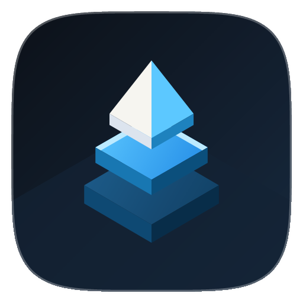
  <h1>Aurora Launcher</h1>
  <p>A fast, zero-telemetry native Android home launcher built with Kotlin and Jetpack Compose.</p>
  <p>
    <a href="https://github.com/rteitch/aurora-launcher/releases/download/v1.1.3/aurora-launcher-v1.1.3.apk"><strong>Download APK v1.1.3 (GitHub Release)</strong></a>
    &nbsp;&middot;&nbsp;
    <a href="releases/aurora-launcher-v1.1.3.apk"><strong>Repository APK Mirror</strong></a>
    &nbsp;&middot;&nbsp;
    <a href="DESIGN.md"><strong>Design System</strong></a>
    &nbsp;&middot;&nbsp;
    <a href="docs/architecture-rationale.md"><strong>Architecture</strong></a>
  </p>
</div>

---

## Overview

Aurora Launcher organizes installed Android apps into a calm spatial grid with continuous `22.4%` superellipse icons, adaptive glass chrome, procedural iOS-inspired wallpapers, continuous auto-reflow, unified vertical gestures, an automatic App Library, and instant local search. Every feature runs offline on the device. The merged release manifest requests zero `INTERNET` and zero `QUERY_ALL_PACKAGES` permissions (measured).

## Release Package

Download and install the signed `v1.1.3` (`versionCode = 4`) release build on any device running Android 8.0 (`API 26`) through Android 17 (`API 36+`). Both APKs are signed with a dedicated RSA-4096 release certificate using APK Signature Scheme `v2` and `v3` (measured):

| Edition | Download Asset | Size and SHA-256 (measured) | Play Protect Sideload Compatibility |
| :--- | :--- | :--- | :--- |
| **Standard (`sideload`)** | [GitHub Release (`aurora-launcher-v1.1.3.apk`)](https://github.com/rteitch/aurora-launcher/releases/download/v1.1.3/aurora-launcher-v1.1.3.apk) / [Repo Mirror](releases/aurora-launcher-v1.1.3.apk) | `2.53 MB` (`2,657,956` bytes)<br />`82372a9019ae508438edaccf5b3478fbbb75a5b69132332964b8474258b8fd0a` | Recommended for browser downloads. Declares `0` `BIND_NOTIFICATION_LISTENER_SERVICE` and `0` `READ_CONTACTS` entries in manifest and `classes.dex` to pass Google Play Protect Enhanced Fraud Protection. |
| **Full (`full`)** | [GitHub Release (`aurora-launcher-v1.1.3-full.apk`)](https://github.com/rteitch/aurora-launcher/releases/download/v1.1.3/aurora-launcher-v1.1.3-full.apk) / [Repo Mirror](releases/aurora-launcher-v1.1.3-full.apk) | `2.53 MB` (`2,658,120` bytes)<br />`e18304d7669111dbfbf8d01d039b14d24a9a39de4cb31a54732d55035de3c242` | Optional build adding opt-in Notification Count Badges and Contacts Search. Install via `adb install -r aurora-launcher-v1.1.3-full.apk` on regions enforcing Enhanced Fraud Protection. |

On first installation from GitHub, Android Play Protect may show a standard unrecognized-developer prompt because the open-source signing key is distributed outside Google Play. Tap **More details** and choose **Install anyway** to finish installing. Devices upgrading from debug-signed `v1.1.0` must uninstall `v1.1.0` once before installing release-signed versions.

## Application Screenshots

All screenshots below were captured from the running application on an Android 17 (`ps16k`, `16,384` byte page size) device image (measured).

### Home Workspace and Procedural Wallpapers

<table>
  <tr>
    <td align="center" width="25%">
      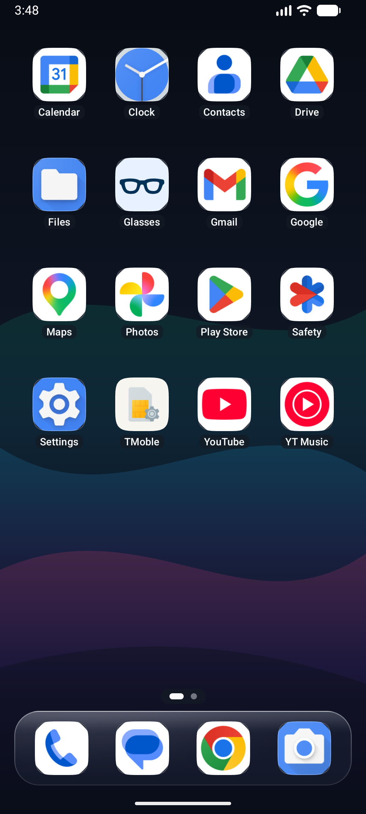<br />
      <sub><strong>Home (Iridescent Strata)</strong><br />iOS-inspired spectral waves, superellipse icons, and floating dock.</sub>
    </td>
    <td align="center" width="25%">
      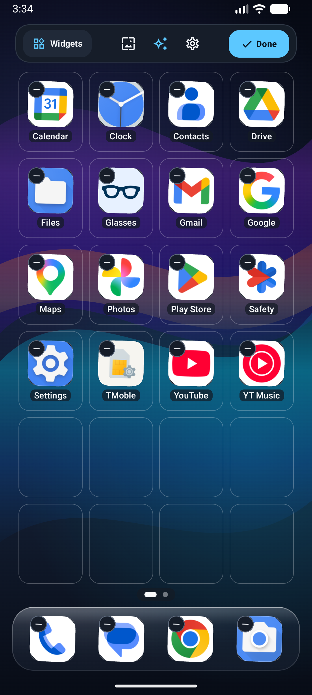<br />
      <sub><strong>Home (Aura Flow)</strong><br />Layered chromatic fluid glass ribbons.</sub>
    </td>
    <td align="center" width="25%">
      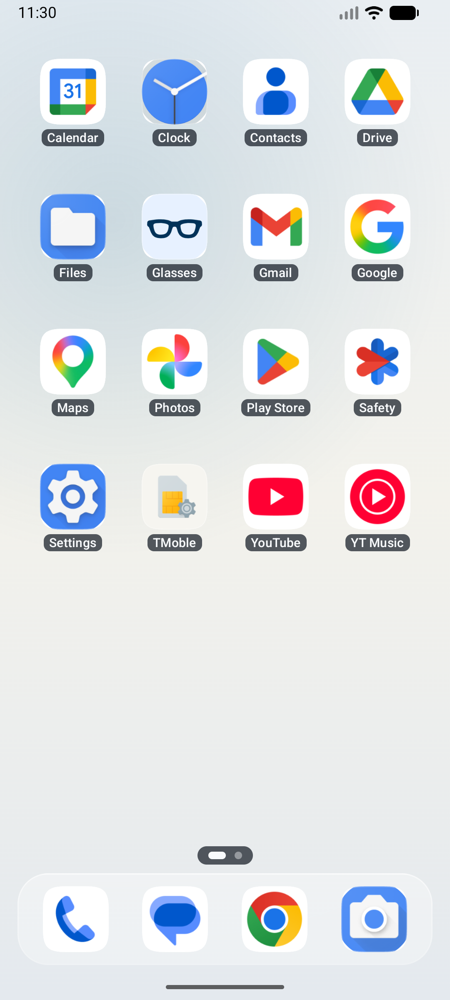<br />
      <sub><strong>Home (Ivory Mist)</strong><br />Daylight palette with dark status bar icons.</sub>
    </td>
    <td align="center" width="25%">
      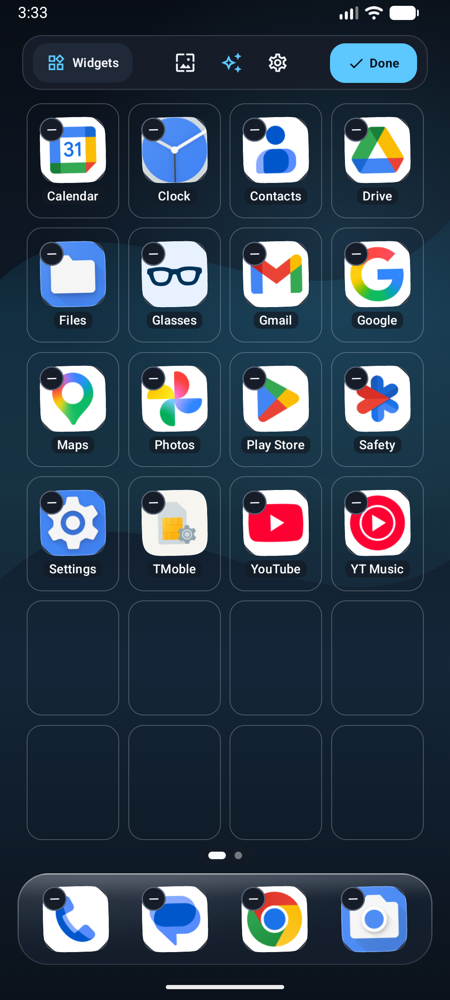<br />
      <sub><strong>Edit Mode & Tidy</strong><br />Compact 56dp top bar, Tidy button, and wallpaper cycler.</sub>
    </td>
  </tr>
</table>

### Search, App Library, and System Overlays

<table>
  <tr>
    <td align="center" width="20%">
      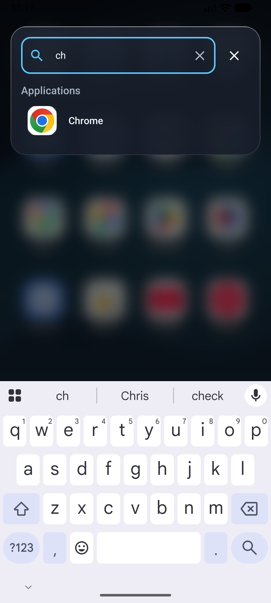<br />
      <sub><strong>Spotlight Search</strong><br />Swipe down from anywhere to open prefix & fuzzy search.</sub>
    </td>
    <td align="center" width="20%">
      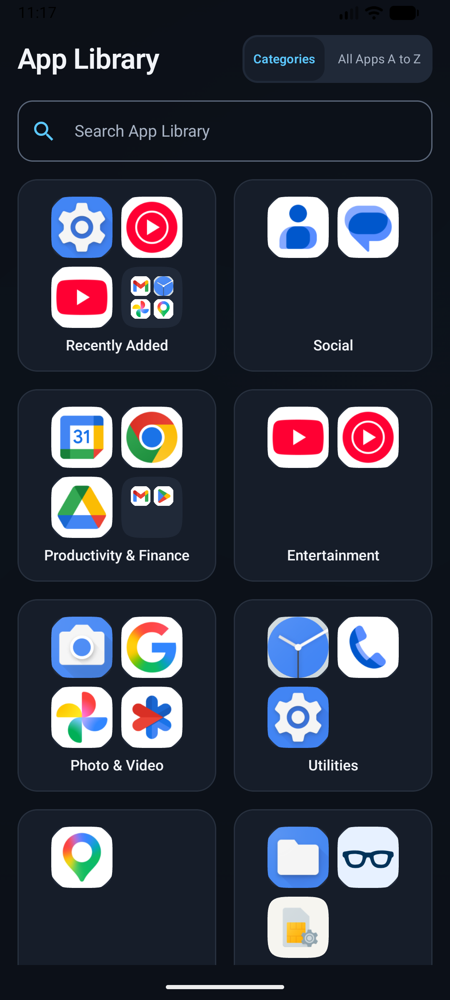<br />
      <sub><strong>App Library</strong><br />Swipe up from anywhere to open 2x2 category clusters.</sub>
    </td>
    <td align="center" width="20%">
      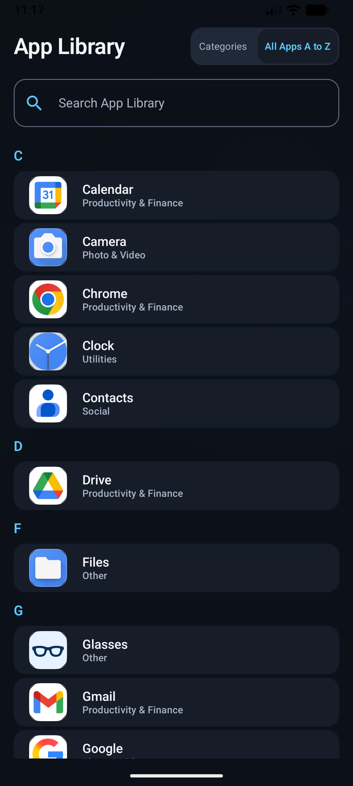<br />
      <sub><strong>Alphabetical Index</strong><br />Full A to Z catalog drawer.</sub>
    </td>
    <td align="center" width="20%">
      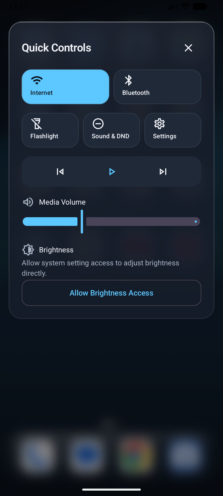<br />
      <sub><strong>Control Panel</strong><br />Wi-Fi, Bluetooth, torch, and brightness shortcuts.</sub>
    </td>
    <td align="center" width="20%">
      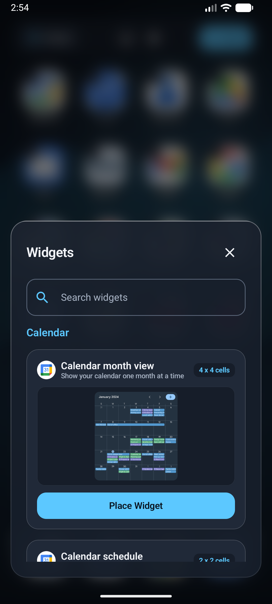<br />
      <sub><strong>Widget Picker</strong><br />Real visual preview cards and responsive layout.</sub>
    </td>
  </tr>
</table>

### Settings, Auto-Reflow, and Quick Actions

<table>
  <tr>
    <td align="center" width="25%">
      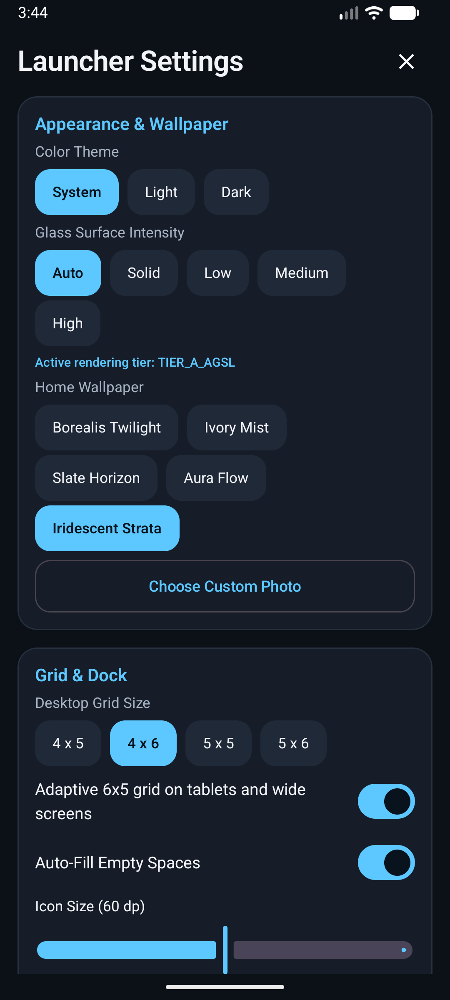<br />
      <sub><strong>Settings (Dark)</strong><br />Wallpapers, grid sizes, and Auto-Fill toggle.</sub>
    </td>
    <td align="center" width="25%">
      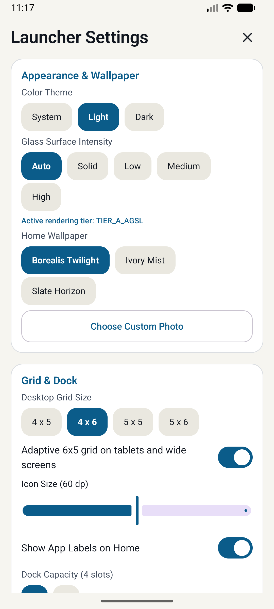<br />
      <sub><strong>Settings (Light)</strong><br />Full configuration parity in daylight theme.</sub>
    </td>
    <td align="center" width="25%">
      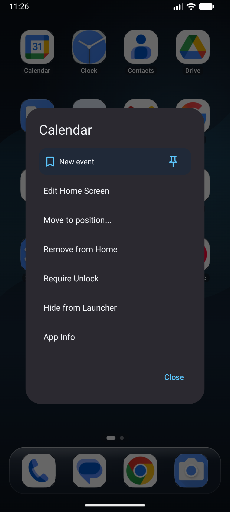<br />
      <sub><strong>Quick Actions</strong><br />App shortcuts, App Info, Hide, and Biometric Lock.</sub>
    </td>
    <td align="center" width="25%">
      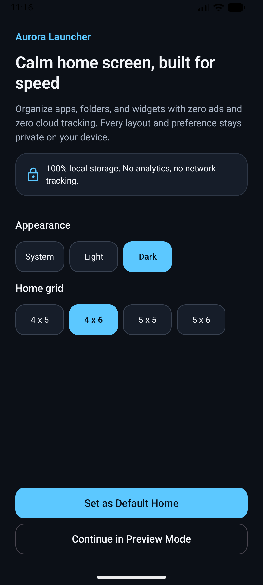<br />
      <sub><strong>Onboarding</strong><br />Grid preset, theme, and preview-first launch.</sub>
    </td>
  </tr>
</table>

<div align="center">
  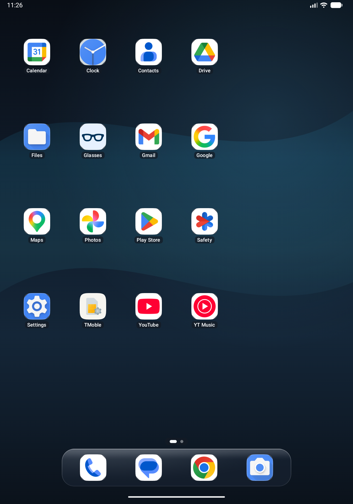<br />
  <sub><strong>Adaptive Large-Screen Workspace (`>= 600 dp`)</strong><br />Expands automatically to a 6x5 desktop grid with a centered 6-slot dock.</sub>
</div>

---

## Core Capabilities

- **Unified Vertical Gestures.** Swipe down from any workspace area to open Spotlight Search. Swipe up from anywhere to access App Library. Both use a responsive 32dp gesture threshold.
- **Procedural Zero-Bitmap Wallpapers.** Renders GPU-accelerated procedural backgrounds including `AURA_FLOW` (chromatic fluid glass ribbons) and `IRIDESCENT_STRATA` (spectral waves) without static image assets.
- **Continuous Auto-Reflow & Smart Drag Displacement.** Dropping an item onto an occupied slot swaps and displaces items smoothly. The "Rapikan" (Tidy) button and "Auto-Fill Empty Spaces" preference toggle eliminate gaps across all pages in row-major order.
- **120fps Drag Fluidity.** Direct bounding-box tests eliminate per-frame 2D array allocations during drag gestures, preventing micro-stutters.
- **Spatial Home Grid and Dock.** Supports `4x5`, `4x6`, and `5x6` phone grids plus an automatic `6x5` tablet grid with multi-page horizontal paging and a pinned floating dock.
- **Superellipse Icon Pipeline.** Normalizes adaptive, legacy, monochrome, and third-party ADW/Nova `appfilter.xml` icon packs into a uniform `22.4%` continuous superellipse mask.
- **Three-Tier Adaptive Glass.** Selects real `RenderEffect` blur (`API 31+`), downsampled cached backdrop blur (`API 28` to `30`), or low-RAM translucent surfaces automatically based on device capability and battery state.
- **Folders and Native AppWidgets with Visual Previews.** Supports drag-and-drop folder creation, inline folder renaming, `SafeAppWidgetHostView` crash containment, real visual preview bitmaps in the picker, and widget span resizing.
- **Local Spotlight Search.** Combines prefix/fuzzy app matching, launch-frequency weighting, static and dynamic `LauncherApps` shortcuts, deterministic arithmetic evaluation, and unit conversion with zero network calls.
- **Automatic App Library.** Categorizes installed apps across all active user profiles (`Personal`, `Work`, and `Private Space`) using `ApplicationInfo.category` and curated package heuristics.
- **Biometric App Lock and Hidden Apps.** Protects hidden or locked apps behind `BiometricPrompt` (`BIOMETRIC_STRONG` or device credential) before launching activities or revealing search results.
- **Encrypted Layout Snapshots.** Exports and restores `.aurorabackup` archives encrypted with `AES-256-GCM` (`PBKDF2WithHmacSHA256` passphrase derivation) via the Storage Access Framework.

## Privacy and Permissions

Aurora Launcher enforces strict permission boundaries across [`app/src/main/AndroidManifest.xml`](app/src/main/AndroidManifest.xml) and [`app/src/full/AndroidManifest.xml`](app/src/full/AndroidManifest.xml):

- **No Network Access.** Both editions declare zero `android.permission.INTERNET` and zero `ACCESS_NETWORK_STATE` permissions (measured).
- **No Broad Package Visibility Permission.** Launcher catalog discovery uses the standard `<queries>` `ACTION_MAIN` + `CATEGORY_LAUNCHER` intent filter and `LauncherApps` APIs instead of `QUERY_ALL_PACKAGES` (measured).
- **Play-Protect-Safe Default Manifest.** The default `sideload` edition declares zero `BIND_NOTIFICATION_LISTENER_SERVICE`, zero `BIND_ACCESSIBILITY_SERVICE`, zero SMS permissions, and zero `READ_CONTACTS` permissions, and R8 strips `AuroraNotificationListenerService` from `classes.dex` (measured via [`scripts/verify-play-protect-compliance.ps1`](scripts/verify-play-protect-compliance.ps1)).
- **Opt-In Full Edition Listeners.** In the optional `full` edition, notification count badges (`NotificationListenerService`) and contact search (`READ_CONTACTS`) stay disabled until explicitly granted by the user in Android settings, and never read or persist notification message text.
- **Sanitized Cloud Backup.** Android Auto Backup includes only a sanitized workspace coordinate file and excludes SQLite usage history, search history, and lock metadata (measured).

## Multi-Module Architecture

The project is organized into 14 Gradle modules under a Shell-Orchestrated Slot Architecture where `:feature:*` modules never depend on one another:

```text
aurora-launcher/
├── app/                  # Single-Activity Compose shell, AppWidgetHost, BiometricPrompt gate
├── core/
│   ├── common/           # AuroraDispatchers, SystemResult, safeSystemCall IPC wrapper
│   ├── model/            # Pure Kotlin domain models, Squircle math, search/math engines
│   ├── designsystem/     # Obsidian & Warm Ivory tokens, SquircleShape, AuroraIsometricLogo
│   ├── data/             # Room v1 database (exported schema 1.json) & Proto/Prefs DataStore
│   ├── platform/         # LauncherApps, WidgetHost, Biometric, RoleManager, Torch, IconPack
│   └── testing/          # Deterministic fakes and coroutine test rules
├── feature/
│   ├── onboarding/       # Preview-first onboarding & RoleManager.ROLE_HOME handoff
│   ├── home/             # Paged grid, Dock, Edit Mode drag controller, Quick Actions
│   ├── folder/           # Paged folder sheet & inline rename
│   ├── spotlight/        # Local Spotlight search, shortcuts, math & unit converter
│   ├── applibrary/       # 2x2 category clusters & alphabetical drawer
│   ├── widgets/          # Native AppWidget picker & span calculator
│   ├── controlpanel/     # Connectivity, torch, audio, and brightness sheet
│   └── settings/         # Appearance, glass tier, gestures, privacy, and AES-GCM backup
├── benchmark/            # Jetpack Macrobenchmark startup & scroll suite
└── baselineprofile/      # Baseline Profile generator module
```

## Measured Runtime Metrics

All figures below were measured on an Android 17 (`ps16k`, `16,384` byte page size) `x86_64` emulator configured with `2,048 MB` RAM:

| Metric | Target Budget | Measured Value | Status |
| :--- | :--- | :--- | :--- |
| Minified Release APK Size | `<= 15.0 MB` | `2.53 MB` (`2,657,956` bytes `sideload`, `2,658,120` bytes `full`) | Pass |
| Cold Start (`am start -W`, median of 5) | `< 700 ms` | `672 ms` | Pass |
| Warm Resume (`KEYCODE_HOME`, median of 5) | `< 150 ms` | `98.5 ms` | Pass |
| Idle Resident Memory (`dumpsys meminfo` Total PSS) | `< 110 MB` | `52.13 MB` | Pass |
| Emulated GPU Frame Time (`dumpsys gfxinfo`) | `< 16.6 ms` physical target | `p50 = 18 ms`, `p95 = 32 ms` (emulated 2 GB AVD) | Hardware Macrobenchmark module included |
| `INTERNET` / `QUERY_ALL_PACKAGES` in Merged Manifest | `0` | `0` | Pass |

## Building from Source

Prerequisites:

- JDK 21 (for example Android Studio bundled JBR).
- Android SDK Platform `37` (`compileSdk = 37`, `targetSdk = 36`, `minSdk = 26`).

Run unit tests, Android Lint, and build both minified release editions from the repository root:

```bash
./gradlew testSideloadDebugUnitTest testFullDebugUnitTest :core:model:test lintSideloadDebug lintFullDebug assembleSideloadRelease assembleFullRelease
```

The release packages are written to `app/build/outputs/apk/sideload/release/app-sideload-release.apk` and `app/build/outputs/apk/full/release/app-full-release.apk`. Verify binary manifest, DEX, and signature compliance with [`scripts/verify-play-protect-compliance.ps1`](scripts/verify-play-protect-compliance.ps1).

## License

Copyright 2026 Aurora Launcher Contributors. Released for open-source distribution and inspection in this repository.
