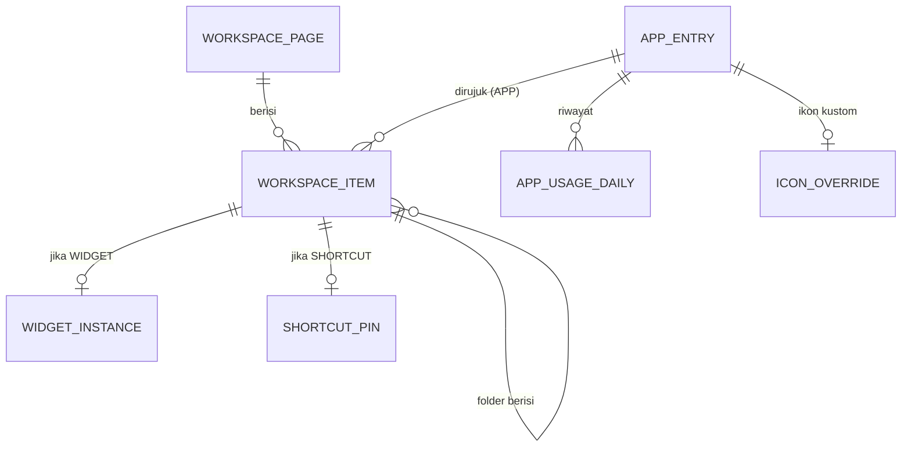

# PRD — Aurora Launcher (nama sementara)

> Launcher Android dengan tampilan terinspirasi iOS (*iOS-inspired*, bukan salinan).
> Dokumen: v0.1 · Tanggal: 26 Oktober 2026 · Status: Draft untuk review
> Catatan: angka performa dan estimasi waktu adalah **target/asumsi**, bukan hasil pengukuran. Item bertanda **[VERIFIKASI]** wajib dicek ulang di dokumentasi resmi sebelum dikerjakan karena cepat berubah.

---

## 1. Ringkasan Eksekutif

**Masalah.** Pengguna Android yang menyukai estetika iOS (grid ikon bersih, dock kaca, App Library, Spotlight, folder) saat ini bergantung pada launcher pihak ketiga yang umumnya penuh iklan, meminta izin berlebihan, atau meniru aset Apple secara langsung sehingga rawan dihapus dari Play Store.

**Solusi.** Launcher Android native yang memberi pengalaman visual dan interaksi *iOS-inspired* dengan aset orisinal, tanpa iklan, privasi-first, dan performa mulus.

**Jawaban singkat "apakah mungkin?"** Ya, ±85–90% tampilan dan interaksi iOS bisa direplikasi. Sisanya dibatasi sistem Android (lihat §3.2).

**Rekomendasi teknologi.** **Android native (Kotlin + Jetpack Compose)**, bukan Flutter (alasan lengkap di §4).

---

## 2. Tujuan & Non-Tujuan

### 2.1 Tujuan (Goals)
| ID | Tujuan | Ukuran sukses (target) |
|----|--------|------------------------|
| G1 | Tampilan & gestur terasa seperti iOS modern | ≥ 4,3/5 pada survei kemiripan visual (beta) |
| G2 | Stabil sebagai launcher harian | Crash-free sessions ≥ 99,5% |
| G3 | Mulus | ≥ 95% frame dalam anggaran 16,6 ms (60 Hz) pada perangkat menengah |
| G4 | Privasi-first | 0 SDK iklan/pelacak; semua data lokal |
| G5 | Lolos kebijakan Google Play | Tidak ada pelanggaran izin/impersonasi saat review |

### 2.2 Non-Tujuan
- Bukan penggantian lock screen, status bar, atau notification shade sistem.
- Tidak menyalin ikon, wallpaper, font, atau nama merek Apple.
- Tidak mendukung iOS/iPadOS (launcher tidak ada di iOS).
- Tidak memakai root, Shizuku, atau API tersembunyi (*hidden API*) di rilis publik.
- Tidak ada Dynamic Island di MVP (memerlukan Accessibility/overlay; risiko kebijakan tinggi).

---

## 3. Analisis Kelayakan

### 3.1 Mekanisme dasar launcher di Android
Sebuah app menjadi launcher dengan mendeklarasikan intent filter `MAIN` + `HOME` + `DEFAULT` pada Activity utamanya; pengguna lalu memilihnya sebagai aplikasi Home default. Untuk menampilkan widget app lain, launcher mengimplementasikan `AppWidgetHost` dan meminta izin bind melalui `ACTION_APPWIDGET_BIND`. Daftar app diambil lewat `LauncherApps` API, dan shortcut/pin lewat `LauncherApps` + `ShortcutInfo`.

### 3.2 Matriks fitur iOS vs kemungkinan di Android

| Fitur gaya iOS | Bisa? | Cara | Catatan/Batasan |
|---|---|---|---|
| Grid ikon + page dots + dock | ✅ Penuh | Compose Canvas/Layout kustom | — |
| Ikon squircle seragam | ✅ | Mask superellipse generik pada adaptive icon | Ikon legacy non-adaptive diberi latar + mask |
| Folder (preview 3×3, buka dengan animasi) | ✅ | Overlay Compose + spring animation | — |
| Mode edit "jiggle" + drag & drop | ✅ | Pointer input + haptic | Wajib alternatif aksesibilitas (TalkBack custom actions) |
| App Library (kategori otomatis) | ✅ Sebagian | `ApplicationInfo.category` + aturan sendiri + riwayat pakai | Klasifikasi tidak seakurat Apple |
| Spotlight (geser turun untuk cari) | ✅ | Search lokal: app, kontak (opsional), pengaturan | Kontak butuh izin, jadikan opsional |
| Widget | ✅ | `AppWidgetHost` + `AppWidgetHostView` via `AndroidView` | Widget stack = fitur kustom launcher |
| Efek kaca/blur dock & folder | ✅ Bertingkat | `RenderEffect` (API 31+), AGSL (API 33+) | Perlu strategi wallpaper, lihat §7.6 |
| Control Center | ⚠️ Sebagian | Panel milik launcher (bukan system shade) | Wi-Fi/Bluetooth tidak bisa di-toggle langsung sejak Android 10; arahkan ke Settings Panel. Senter, volume, media bisa |
| Notification Center / status bar iOS | ❌ | — | Milik sistem; tidak bisa diganti oleh launcher |
| Lock screen iOS | ❌ | — | Di luar lingkup launcher |
| Dynamic Island | ❌ (MVP) | Butuh overlay/Accessibility | Risiko kebijakan Play tinggi |
| Animasi buka app dari ikon (zoom mulus) | ⚠️ Sebagian | `ActivityOptions.makeScaleUpAnimation`/`makeClipRevealAnimation` | Animasi jendela-ke-ikon penuh milik komponen sistem/Recents |
| Recents/App Switcher gaya iOS | ❌ | — | Terintegrasi dengan komponen sistem; launcher pihak ketiga tidak bisa menggantinya tanpa privilese |
| Gesture swipe-up-to-home mulus | ⚠️ | Perilaku bergantung OEM | Uji di Pixel, Samsung, Xiaomi |
| Notification badge (titik/angka) | ✅ Opsional | `NotificationListenerService` | Izin sensitif; opt-in, hanya hitung per paket |
| Kunci/sembunyikan app | ✅ Sebagian | `BiometricPrompt` di level launcher | Hanya melindungi lewat launcher ini; Android 17 punya App Lock sistem |
| Work profile / Private Space | ✅ | `LauncherApps` + `UserHandle` | Wajib ditangani (§10) |

**Kesimpulan:** secara visual dan interaksi dalam jendela launcher, hampir semua bisa. Yang di luar jendela launcher (status bar, shade, lock screen, recents) tidak bisa.

---

## 4. Keputusan Teknologi: Flutter vs Android Native

### 4.1 Temuan riset
1. **Flutter tidak punya keunggulan lintas-platform di sini.** Nilai jual utama Flutter adalah satu basis kode untuk Android dan iOS. Launcher hanya ada di Android, sehingga keunggulan itu hilang.
2. **Semua inti launcher adalah API Android.** Intent HOME, `LauncherApps`, `AppWidgetHost`, `ShortcutInfo`, `NotificationListenerService`, `WallpaperManager`, `UserManager`. Di Flutter semuanya harus dibungkus *platform channel* atau *plugin* kustom (plugin yang ada hanya mencakup cek/pilih launcher default, bukan fungsi launcher itu sendiri).
3. **Widget app lain harus berupa native View.** `AppWidgetHostView` adalah View Android; di Flutter ia harus ditanam sebagai *PlatformView*. Riset menunjukkan performa platform view di Android pada Impeller masih punya isu terbuka di beberapa perangkat **[VERIFIKASI]**. Ini jantung fitur widget dan area paling rawan jank.
4. **Launcher = proses yang selalu hidup.** Flutter menambah overhead engine/isolate di proses yang paling sering dibuka dan dipertahankan. Estimasi overhead memori perlu diukur lewat spike, bukan diasumsikan.
5. **Referensi industri.** Launcher open source besar (Lawnchair, berbasis Launcher3/AOSP) memakai arsitektur hibrida View + Jetpack Compose, dan memigrasikan ke Compose bertahap, termasuk memakai `AndroidView` di dalam Compose untuk komponen lama yang kompleks.
6. **Efek kaca.** Di Android native, `RenderEffect` (API 31+) dan AGSL `RuntimeShader` (API 33+) tersedia langsung di Compose, dan sudah ada library komunitas (mis. liquid-glass untuk Compose) dengan degradasi mulus di API lebih rendah.
7. **Kebijakan Play.** Target API wajib 36 untuk app baru/update sejak 31 Agustus 2026. App Flutter juga terkena aturan ini lewat plugin native, jadi Flutter tidak menghindarkan pekerjaan native.

### 4.2 Perbandingan

| Kriteria (bobot) | Native Kotlin + Compose | Flutter | Pemenang |
|---|---|---|---|
| Akses API launcher (25%) | Langsung | Lewat channel/plugin kustom | Native |
| Widget host (20%) | `AppWidgetHostView` asli | PlatformView, risiko performa | Native |
| Performa & memori proses always-on (15%) | Lebih ringan | Overhead engine | Native |
| Efek kaca/blur (10%) | `RenderEffect`/AGSL langsung | Shader tersedia, tapi tidak bisa sampling jendela belakang | Native |
| Kecepatan membangun UI kustom (10%) | Cepat (Compose) | Cepat | Seri |
| Ekosistem referensi launcher (10%) | Launcher3, Lawnchair | Nyaris tidak ada | Native |
| Kompatibilitas OEM/edge case (5%) | Debug langsung | Dua lapis debug | Native |
| Cross-platform (5%) | Tidak relevan | Tidak relevan | Seri |

### 4.3 Keputusan
**Android native: Kotlin + Jetpack Compose**, dengan `AndroidView` untuk `AppWidgetHostView`.

Pertimbangkan Flutter **hanya jika** Anda sudah sangat mahir Flutter dan nol pengalaman Android, dan siap menulis >50% kode native. Bahkan itu, estimasi total kerja kemungkinan lebih besar, bukan lebih kecil.

> Pendekatan lain yang dipertimbangkan: fork Launcher3/Lawnchair (AOSP, lisensi GPLv3). **Tidak direkomendasikan** karena (a) lisensi GPLv3 mewajibkan kode sumber terbuka, (b) basis kode besar berbasis View yang sulit diberi tampilan iOS, (c) beban sinkronisasi dengan rilis Android baru.

---

## 5. Lingkup Produk

### 5.1 MVP (v1.0)
Onboarding + set default, home grid multi-halaman, dock, folder, mode edit, App Library, Spotlight (app saja), widget (host standar), pengaturan dasar (grid, ukuran ikon, label, tema gelap/terang), ikon bertema, backup/restore layout lokal, long-press shortcut menu, sembunyikan app.

### 5.2 v1.1
Widget stack, Control Panel milik launcher, notification badge (opt-in), kunci app biometrik, dukungan icon pack, pencarian kontak/pengaturan (opsional), tablet/foldable adaptif.

### 5.3 v2.0
Efek kaca tingkat lanjut (refraksi, AGSL), wallpaper parallax/depth, rekomendasi app berbasis riwayat pakai (lokal), gesture kustom per app.

---

## 6. Persona & Use Case

### 6.1 Persona
| Persona | Deskripsi | Kebutuhan utama |
|---|---|---|
| **Rina**, 22, mahasiswa | HP Android menengah, suka estetika iOS | Tampilan rapi, tidak berat, tanpa iklan |
| **Dito**, 29, pindahan iPhone | Terbiasa App Library & Spotlight | Alur yang familier |
| **Bu Sari**, 45 | Butuh tampilan sederhana | Ikon besar, label jelas, aksesibilitas |
| **Andi**, 33, power user | Banyak app, work profile | Stabil, kustomisasi, backup |

### 6.2 Daftar Use Case

| ID | Use Case | Aktor | Prioritas |
|---|---|---|---|
| UC-01 | Onboarding & jadikan launcher default | Pengguna | P0 |
| UC-02 | Lihat & geser halaman home | Pengguna | P0 |
| UC-03 | Buka aplikasi dari ikon | Pengguna | P0 |
| UC-04 | Mode edit: atur ulang ikon | Pengguna | P0 |
| UC-05 | Buat/ubah/hapus folder | Pengguna | P0 |
| UC-06 | Hapus dari home vs copot pemasangan | Pengguna | P0 |
| UC-07 | Jelajahi App Library | Pengguna | P0 |
| UC-08 | Cari lewat Spotlight | Pengguna | P0 |
| UC-09 | Tambah/ubah ukuran/hapus widget | Pengguna | P0 |
| UC-10 | Widget stack | Pengguna | P1 |
| UC-11 | Control Panel | Pengguna | P1 |
| UC-12 | Sembunyikan / kunci aplikasi | Pengguna | P1 |
| UC-13 | Ganti tema, ikon, grid | Pengguna | P0 |
| UC-14 | Backup & restore layout | Pengguna | P1 |
| UC-15 | Lihat notification badge | Pengguna | P1 |
| UC-16 | Menu long-press (app shortcuts) | Pengguna | P0 |
| UC-17 | Respons install/update/uninstall otomatis | Sistem | P0 |
| UC-18 | Work profile / Private Space | Pengguna | P1 |
| UC-19 | Pin shortcut/widget dari app lain | Sistem/App lain | P1 |
| UC-20 | Kembali ke launcher lama | Pengguna | P0 |

### 6.3 Alur rinci use case kunci

**UC-01 Onboarding & set default**
- *Prasyarat:* app baru terpasang, belum default.
- *Alur utama:* (1) Layar sambut → (2) jelaskan izin yang **tidak** diminta (tanpa akses kontak/notifikasi dulu) → (3) tombol "Jadikan launcher utama" memanggil `RoleManager.createRequestRoleIntent(ROLE_HOME)` → (4) pengguna menyetujui → (5) pilih gaya awal (terang/gelap, ukuran grid) → (6) layout awal dibuat dari app terpasang.
- *Alternatif:* pengguna menolak → tampilkan layar ringkas dengan tombol coba lagi + pintasan ke Settings > Default apps. Launcher tetap bisa dipakai sebagai app biasa (mode pratinjau).
- *Pasca-kondisi:* app menjadi `ROLE_HOME`; layout awal tersimpan.

**UC-04 Mode edit**
- *Pemicu:* tekan lama ikon/area kosong.
- *Alur:* ikon bergetar halus (*jiggle*, hormati setelan "kurangi gerakan") → drag ikon → halaman bergeser saat menyentuh tepi → lepas → posisi disimpan dalam satu transaksi → tombol "Selesai".
- *Alternatif:* tepi kiri dari halaman pertama → tidak membuat halaman baru; tepi kanan halaman terakhir yang terisi → membuat halaman baru (dihapus otomatis jika kosong saat keluar mode edit).
- *Aksesibilitas:* `customActions` ("Pindahkan ke kiri/kanan/atas/bawah", "Pindahkan ke halaman berikutnya").

**UC-06 Hapus dari home vs copot**
- Menu long-press menampilkan "Hapus dari Layar Utama" (hanya menghapus entri layout) dan "Copot Pemasangan" (memanggil `ACTION_DELETE`; ditampilkan hanya jika app boleh dicopot). App sistem: hanya "Hapus dari Layar Utama" dan, bila perlu, "Sembunyikan".

**UC-08 Spotlight**
- Geser turun di area kosong home (bukan dari tepi atas, yang milik sistem). Hasil: app (cocok awalan/sub-string/inisial), riwayat singkat, saran berbasis pemakaian (lokal). Pencarian berjalan di Flow dengan debounce ±100 ms dan indeks in-memory.

**UC-09 Widget**
- Pilih widget → `ACTION_APPWIDGET_BIND` bila belum diizinkan → jika provider punya activity konfigurasi, jalankan `ACTION_APPWIDGET_CONFIGURE` → tempatkan di grid pada sel kosong yang cukup → simpan `appWidgetId` ke DB.
- *Gagal:* tidak ada ruang → tampilkan pesan dan tawarkan halaman baru.

**UC-17 Respons paket berubah**
- Registrasikan `LauncherApps.Callback` (bukan broadcast). Install: tambah ke App Library, dan (opsional) ke home jika ada ruang. Update: segarkan ikon/label. Uninstall: hapus entri dari layout, folder, dan widget terkait; folder dengan 1 sisa item otomatis dibubarkan.

---

## 7. Desain

### 7.1 Prinsip
1. **Ringan dulu, kaca belakangan.** Efek mahal hanya jika perangkat mampu (tiering §7.6).
2. **Orisinal.** Terinspirasi, bukan salinan aset Apple (§12).
3. **Selalu responsif.** Interaksi < 100 ms; semua animasi bisa dimatikan.
4. **Dapat diakses.** Kontras, TalkBack, skala font, kurangi gerakan.

### 7.2 Tata letak (default, ponsel)
- Grid **4 kolom × 6 baris** + dock 4 slot. Opsi: 4×5, 5×6, 5×5.
- Margin horizontal 20 dp; jarak vertikal antar baris menyesuaikan tinggi layar.
- Ikon 60 dp (opsi 52–68 dp); label 11–12 sp, 1 baris, ellipsis; label bisa dimatikan.
- Page dots di atas dock; indikator "halaman aktif" tegas.
- Layar ≥ 600 dp (tablet/foldable): grid adaptif (mis. 6×5) dan dock memusat; terapkan *adaptive layout*.
- Edge-to-edge (wajib untuk target API 36): konten tidak boleh tertutup status/nav bar; gunakan insets.

### 7.3 Design tokens
```
radius.icon        = 22.4% dari sisi ikon (superellipse/squircle generik)
radius.folder      = 24dp
radius.dock        = 28dp
space.xs/sm/md/lg  = 4 / 8 / 16 / 24 dp
blur.dock          = 24–32 dp (tier A/B)
glass.tint.light   = putih alpha 0.22   | glass.tint.dark = hitam alpha 0.28
glass.hairline     = 1 dp, putih alpha 0.35 (sorotan tepi)
motion.spring.default = damping 0.8, stiffness medium-low
motion.open_app       = scale-up dari posisi ikon, ±300 ms
motion.folder_open    = spring, ±350 ms
```
Font: **Inter** atau **Roboto Flex** (lisensi terbuka). **Jangan memakai SF Pro** (lisensi Apple membatasi penggunaannya pada platform Apple).

### 7.4 Komponen
| Komponen | Perilaku utama |
|---|---|
| `Workspace` | Pager horizontal, grid tetap, drag & drop, auto-scroll di tepi |
| `Dock` | Maks 4–5 item, kaca, ikut tema |
| `AppIcon` | Adaptive icon + mask + (opsional) monokrom bertema |
| `Folder` | Pratinjau 3×3, buka ke overlay dengan blur latar, ganti nama inline |
| `AppLibrary` | Halaman paling kanan: kartu kategori 2×2 + daftar abjad + pencarian |
| `Spotlight` | Overlay pencarian, papan ketik muncul otomatis |
| `ControlPanel` | Ubin: senter, volume, kecerahan*, media, pintasan Settings |
| `WidgetHost` | `AndroidView` membungkus `AppWidgetHostView`, ukuran snap ke grid |
| `QuickActionsMenu` | Muncul pada tekan lama: shortcut app, Hapus, Bagikan, Info |

\* kecerahan butuh `WRITE_SETTINGS`; jadikan opsional.

### 7.5 Alur layar (ringkas)
```
Onboarding → Home (halaman 1..N) ⇄ App Library
                │  ├─ tekan lama → Quick Actions / Mode Edit
                │  ├─ geser turun → Spotlight
                │  ├─ ketuk folder → Folder overlay
                │  └─ (v1.1) geser turun kanan-atas → Control Panel
                └→ Pengaturan (Tampilan, Grid, Ikon, Gesture, Privasi, Backup, Tentang)
```

### 7.6 Strategi efek kaca (area teknis paling berisiko)
`RenderEffect` pada Compose mengaburkan **konten yang digambar dalam jendela yang sama**, bukan wallpaper sistem yang berada di luar jendela. Karena itu:

| Strategi | Cara | Kelebihan | Kekurangan |
|---|---|---|---|
| **A. Wallpaper dalam-app (default)** | Pengguna memilih wallpaper lewat picker launcher; launcher menggambar salinannya sendiri sebagai lapisan terbawah | Backdrop blur penuh & presisi untuk dock/folder | Tidak mendukung live wallpaper; memakai memori bitmap |
| **B. Wallpaper sistem + blur jendela** | `Window.setBackgroundBlurRadius` (API 31+) untuk overlay tertentu (folder, Spotlight) | Mendukung wallpaper sistem | Blur seluruh jendela, bergantung dukungan perangkat/penghemat baterai |
| **C. Fallback** | Panel semi-transparan + hairline | Berjalan di mana saja | Kurang "kaca" |

**Tier perangkat:** Tier A (API 33+ & GPU cukup): blur + refraksi AGSL. Tier B (API 31–32): blur saja. Tier C (API < 31 atau perangkat lemah/penghemat daya): panel solid translucent. Pemilihan otomatis + bisa diubah manual. **Spike S-01 wajib** sebelum mengunci desain visual.

### 7.7 Aksesibilitas
Kontras teks ≥ 4,5:1 di atas kaca (uji pada wallpaper terang/gelap); TalkBack untuk semua aksi drag; target sentuh ≥ 48 dp; hormati font scale hingga 200% dan "hapus animasi"; dukungan RTL.

---

## 8. Arsitektur & Struktur Project

### 8.1 Arsitektur
- **Pola:** MVVM + unidirectional data flow (state `StateFlow`, event `SharedFlow`).
- **Lapisan:** UI (Compose) → ViewModel → UseCase → Repository → Data source (Room, DataStore, sistem Android).
- **Concurrency:** Coroutines/Flow; I/O di `Dispatchers.IO`; semua pemanggilan `PackageManager`/`LauncherApps` dibungkus try/catch (mis. `DeadSystemException`, `SecurityException`, `NameNotFoundException`).
- **DI:** Hilt (atau Koin). **Navigasi:** Navigation Compose type-safe untuk Pengaturan; Home memakai state machine sendiri.
- **Stack [VERIFIKASI versi terbaru]:** Kotlin 2.x, Compose BOM terbaru, AGP/Gradle sesuai matriks resmi, Room, DataStore (Proto), Coil, Baseline Profiles, Macrobenchmark.
- **SDK:** `compileSdk` = terbaru yang stabil; **`targetSdk` ≥ 36** (syarat Play); `minSdk` 26 (usulan; sesuaikan data pasar target).

### 8.2 Struktur project (multi-module)
```
aurora-launcher/
├── build-logic/                      # convention plugins Gradle
├── app/                              # entry point, manifest, DI root
│   └── src/main/
│       ├── AndroidManifest.xml       # intent-filter HOME, queries, layanan
│       └── kotlin/.../LauncherActivity.kt
├── core/
│   ├── model/                        # data class domain (AppEntry, WorkspaceItem, ...)
│   ├── common/                       # util, Result, dispatcher
│   ├── designsystem/                 # tema, token, AppIcon, GlassSurface, motion
│   ├── data/                         # Room DB, DAO, DataStore, repository impl
│   ├── platform/                     # pembungkus API Android
│   │   ├── LauncherAppsGateway.kt
│   │   ├── AppWidgetHostManager.kt
│   │   ├── ShortcutGateway.kt
│   │   ├── WallpaperGateway.kt
│   │   └── NotificationBadgeService.kt   # opsional
│   └── testing/                      # fake, rule, helper test
├── feature/
│   ├── home/                         # Workspace, Dock, drag-drop, mode edit
│   ├── folder/
│   ├── applibrary/
│   ├── spotlight/
│   ├── widgets/                      # picker, host, stack
│   ├── controlpanel/                 # v1.1
│   ├── settings/
│   └── onboarding/
├── baselineprofile/                  # profil startup
├── benchmark/                        # Macrobenchmark (jank, startup)
├── docs/                             # prd.md, ADR, panduan kontribusi
└── gradle/libs.versions.toml         # version catalog
```
Aturan dependensi: `feature → core`, **tidak boleh** `feature → feature`; `core:data → core:model`; `core:designsystem` tidak tahu logika bisnis.

### 8.3 Konfigurasi Manifest (kerangka)
```xml
<activity android:name=".LauncherActivity"
    android:exported="true"
    android:launchMode="singleTask"
    android:taskAffinity=""
    android:stateNotNeeded="true"
    android:resumeWhilePausing="true"
    android:screenOrientation="unspecified"
    android:configChanges="orientation|screenSize|smallestScreenSize|screenLayout|keyboardHidden|uiMode|density">
  <intent-filter>
    <action android:name="android.intent.action.MAIN"/>
    <category android:name="android.intent.category.HOME"/>
    <category android:name="android.intent.category.DEFAULT"/>
  </intent-filter>
</activity>

<!-- Terima permintaan pin shortcut/widget -->
<activity android:name=".PinRequestActivity" android:exported="true">
  <intent-filter>
    <action android:name="android.content.pm.action.CONFIRM_PIN_SHORTCUT"/>
    <category android:name="android.intent.category.DEFAULT"/>
  </intent-filter>
</activity>

<queries>
  <intent>
    <action android:name="android.intent.action.MAIN"/>
    <category android:name="android.intent.category.LAUNCHER"/>
  </intent>
</queries>
```
`<queries>` dengan intent MAIN/LAUNCHER cukup untuk melihat app yang bisa diluncurkan, **tanpa** `QUERY_ALL_PACKAGES`.

---

## 9. Database

### 9.1 Pilihan penyimpanan
- **Room (SQLite):** layout, entri app, widget, riwayat. `exportSchema = true`, migrasi otomatis + uji migrasi.
- **DataStore (Proto):** preferensi (grid, tema, intensitas kaca, gesture).
- **File internal:** salinan wallpaper dalam-app, cache ikon (bukan di DB).
- Semua di penyimpanan privat app; **tidak** ada database di storage eksternal.

### 9.2 ER diagram


### 9.3 Skema (SQL)
```sql
CREATE TABLE workspace_page (
  id          INTEGER PRIMARY KEY AUTOINCREMENT,
  position    INTEGER NOT NULL UNIQUE,
  created_at  INTEGER NOT NULL
);

CREATE TABLE workspace_item (
  id            INTEGER PRIMARY KEY AUTOINCREMENT,
  type          TEXT NOT NULL CHECK (type IN ('APP','FOLDER','WIDGET','SHORTCUT')),
  container     TEXT NOT NULL CHECK (container IN ('DESKTOP','DOCK','FOLDER')),
  container_id  INTEGER,                 -- page.id | folder item.id | NULL (DOCK)
  cell_x        INTEGER NOT NULL DEFAULT 0,
  cell_y        INTEGER NOT NULL DEFAULT 0,
  span_x        INTEGER NOT NULL DEFAULT 1,
  span_y        INTEGER NOT NULL DEFAULT 1,
  rank          INTEGER NOT NULL DEFAULT 0, -- urutan di dock/folder
  title         TEXT,                        -- nama folder
  package_name  TEXT,
  activity_class TEXT,
  user_serial   INTEGER NOT NULL DEFAULT 0,  -- profil (utama/work/private)
  created_at    INTEGER NOT NULL,
  updated_at    INTEGER NOT NULL
);
CREATE INDEX idx_item_container ON workspace_item(container, container_id);
CREATE UNIQUE INDEX uq_item_cell
  ON workspace_item(container, container_id, cell_x, cell_y)
  WHERE span_x = 1 AND span_y = 1 AND container <> 'FOLDER';
-- Tumpang tindih item ber-span (widget) divalidasi di repository dalam transaksi.

CREATE TABLE app_entry (
  package_name   TEXT NOT NULL,
  activity_class TEXT NOT NULL,
  user_serial    INTEGER NOT NULL,
  label          TEXT NOT NULL,
  label_sort_key TEXT NOT NULL,
  category       INTEGER,               -- ApplicationInfo.category
  library_group  TEXT,                  -- hasil klasifikasi App Library
  is_hidden      INTEGER NOT NULL DEFAULT 0,
  is_locked      INTEGER NOT NULL DEFAULT 0,
  is_system      INTEGER NOT NULL DEFAULT 0,
  install_time   INTEGER,
  update_time    INTEGER,
  launch_count   INTEGER NOT NULL DEFAULT 0,
  last_launch_at INTEGER,
  PRIMARY KEY (package_name, activity_class, user_serial)
);
CREATE INDEX idx_app_label ON app_entry(label_sort_key);

CREATE TABLE widget_instance (
  app_widget_id     INTEGER PRIMARY KEY,
  item_id           INTEGER NOT NULL REFERENCES workspace_item(id) ON DELETE CASCADE,
  provider_package  TEXT NOT NULL,
  provider_class    TEXT NOT NULL,
  user_serial       INTEGER NOT NULL DEFAULT 0,
  needs_config      INTEGER NOT NULL DEFAULT 0
);

CREATE TABLE shortcut_pin (
  item_id      INTEGER PRIMARY KEY REFERENCES workspace_item(id) ON DELETE CASCADE,
  shortcut_id  TEXT NOT NULL,
  package_name TEXT NOT NULL,
  user_serial  INTEGER NOT NULL DEFAULT 0
);

CREATE TABLE icon_override (
  package_name TEXT NOT NULL,
  activity_class TEXT NOT NULL,
  pack_id      TEXT NOT NULL,
  drawable_name TEXT NOT NULL,
  PRIMARY KEY (package_name, activity_class)
);

CREATE TABLE app_usage_daily (          -- lokal saja, retensi 30 hari
  package_name TEXT NOT NULL,
  day          INTEGER NOT NULL,        -- epoch day
  launches     INTEGER NOT NULL DEFAULT 0,
  PRIMARY KEY (package_name, day)
);

CREATE TABLE search_history (            -- dapat dimatikan; maks 50 baris
  id    INTEGER PRIMARY KEY AUTOINCREMENT,
  query TEXT NOT NULL,
  ts    INTEGER NOT NULL
);

CREATE TABLE layout_snapshot (           -- undo & backup otomatis, simpan 5 terakhir
  id             INTEGER PRIMARY KEY AUTOINCREMENT,
  schema_version INTEGER NOT NULL,
  created_at     INTEGER NOT NULL,
  json_blob      TEXT NOT NULL
);
```

### 9.4 Aturan data
- Perubahan layout (drag, buat folder, hapus) = **satu transaksi** + snapshot sebelum perubahan besar.
- `app_entry` adalah cache yang dapat dibangun ulang dari `LauncherApps`; sumber kebenaran daftar app tetap sistem.
- Item layout yang paketnya tidak ada lagi: tandai "yatim" dan tampilkan placeholder 7 hari sebelum dibersihkan (menangani app sementara hilang, mis. saat update/penyimpanan SD dilepas).
- Migrasi: `AutoMigration` jika memungkinkan; migrasi manual dengan uji `MigrationTestHelper`; **dilarang** `fallbackToDestructiveMigration` di rilis.

### 9.5 Backup & restore
- Ekspor JSON versi-skema ke URI pilihan pengguna (`ACTION_CREATE_DOCUMENT`, tanpa izin storage).
- Impor: validasi skema, batas ukuran (mis. ≤ 5 MB), batas jumlah item, abaikan field tak dikenal, paket yang belum terpasang menjadi placeholder.
- Cloud backup Android: sertakan hanya layout + preferensi; **kecualikan** riwayat pencarian, penggunaan, dan status kunci app (`dataExtractionRules`).

---

## 10. Edge Case

| # | Area | Skenario | Penanganan |
|---|---|---|---|
| E1 | Sistem | Pengguna belum/membatalkan set default | Mode pratinjau + CTA ulang; jangan memblokir |
| E2 | Sistem | Launcher dipilih lalu app dicopot | Android memulihkan ke launcher bawaan; data lokal ikut terhapus; sediakan ekspor sebelum copot |
| E3 | Proses | Proses dimatikan sistem (memori rendah) lalu dibuka lagi | Restore state dari DB; tampilan awal < 1 detik tanpa layar kosong |
| E4 | Proses | OEM agresif (Xiaomi/Oppo/Vivo/Samsung) mematikan launcher di background | Panduan pengecualian baterai; deteksi *cold start* tak wajar; log lokal |
| E5 | Paket | Install/update/uninstall saat drag berlangsung | Antrikan perubahan DB hingga drag selesai; batalkan drag bila item sumber hilang |
| E6 | Paket | App ditangguhkan/disuspend (`suspended`) atau dinonaktifkan | Ikon abu-abu + pesan saat diketuk; tidak crash |
| E7 | Paket | Satu paket punya banyak aktivitas launcher | Kunci per `(package, activity, user)`, bukan hanya package |
| E8 | Paket | App tanpa adaptive icon | Pasang latar netral + mask squircle + padding |
| E9 | Profil | Work profile aktif/nonaktif/dijeda | Ikon dengan lencana kerja; abu-abu saat dijeda; sembunyikan saat profil dihapus |
| E10 | Profil | Private Space terkunci/terbuka | Jangan menampilkan atau mengindeks app privat saat terkunci; hapus dari Spotlight/recents/cache saat dikunci |
| E11 | Profil | App ganda (clone) dengan label sama | Bedakan lewat lencana profil; sort stabil |
| E12 | Widget | Provider widget di-uninstall/diperbarui | Ganti dengan placeholder, tawarkan hapus; jangan crash host |
| E13 | Widget | Widget memerlukan activity konfigurasi | Alur konfigurasi; batal → batalkan penempatan & `deleteAppWidgetId` |
| E14 | Widget | Widget lambat/crash, `RemoteViews` error | Bungkus view error; tampilkan "Widget tidak dapat dimuat" |
| E15 | Widget | Ukuran widget tidak muat setelah ganti grid | Skala/relokasi otomatis; jika gagal pindah ke halaman baru |
| E16 | Layout | Mengganti ukuran grid (mis. 4×6 → 5×5) | Algoritma reflow deterministik + snapshot + undo |
| E17 | Layout | Folder tersisa 1 item / kosong | Bubarkan otomatis; kembalikan item ke posisi folder |
| E18 | Layout | Drop ke sel penuh / di luar area | Animasikan kembali ke posisi asal; haptic penolakan |
| E19 | Layout | Halaman kosong / terlalu banyak halaman | Hapus halaman kosong otomatis; batas maks halaman (mis. 15) |
| E20 | Layar | Rotasi, lipat/buka foldable, split-screen, mode desktop | Layout adaptif; jaga state; jangan reset scroll |
| E21 | Layar | Font/Display size sangat besar | Label wrap/ellipsis; grid menyesuaikan tinggi |
| E22 | Layar | Tablet/ukuran ≥ 600 dp | Grid adaptif, bukan sekadar membentang |
| E23 | Aksesibilitas | Drag tidak mungkin dengan TalkBack/switch | `customActions` + dialog "Pindahkan ke…" |
| E24 | Efek | Penghemat baterai/blur dimatikan sistem | Turunkan ke tier C otomatis |
| E25 | Efek | Perangkat low-RAM (Android Go) | Mode ringan: tanpa blur/animasi berat, cache ikon kecil |
| E26 | Efek | `Reduce motion` aktif | Nonaktifkan jiggle & transisi besar |
| E27 | Wallpaper | Live wallpaper/ wallpaper berubah di luar app | Fallback strategi B/C; sinkron saat `onResume` |
| E28 | Izin | NotificationListener dicabut saat berjalan | Sembunyikan badge, tampilkan petunjuk satu kali; tanpa crash |
| E29 | Izin | Biometrik tak tersedia/berubah | Fallback PIN perangkat (`DEVICE_CREDENTIAL`); kunci tetap aman |
| E30 | Keamanan | Intent HOME/pin dari app jahat | Validasi pengirim & payload (§11) |
| E31 | Data | Database rusak / migrasi gagal | Pulihkan dari snapshot terakhir; jika gagal, bangun ulang layout default dan beri tahu pengguna |
| E32 | Data | File backup korup atau berbahaya | Validasi ketat, batas ukuran, tolak dengan pesan jelas |
| E33 | Pencarian | Nama app dengan karakter khusus/emoji/non-Latin | Normalisasi Unicode + sort key ber-locale |
| E34 | Jaringan/Locale | Ganti bahasa, zona waktu, RTL | Muat ulang label; mirror layout RTL |
| E35 | Build | Library native tak mendukung halaman memori 16 KB | Cek di CI dengan emulator 16 KB; update dependensi |

---

## 11. Keamanan & Privasi

### 11.1 Prinsip
**Minimal izin, lokal dulu, transparan.** Launcher melihat daftar app, kebiasaan pakai, dan notifikasi, sehingga bersifat sensitif secara privasi. Aurora memperlakukan semuanya sebagai data pengguna yang tidak pernah meninggalkan perangkat.

### 11.2 Izin & akses

| Izin/Akses | Dipakai untuk | Kebutuhan | Catatan |
|---|---|---|---|
| `MAIN/HOME` intent filter | Menjadi launcher | Wajib | Via `RoleManager` |
| `<queries>` MAIN/LAUNCHER | Daftar app | Wajib | **Tidak** pakai `QUERY_ALL_PACKAGES` |
| `ACTION_APPWIDGET_BIND` (prompt pengguna) | Host widget | Wajib untuk widget | Persetujuan per widget |
| `REQUEST_DELETE_PACKAGES` | Copot app | Opsional | Hanya jika fitur copot dipakai |
| `BIND_NOTIFICATION_LISTENER_SERVICE` | Badge | Opsional (v1.1) | Opt-in, dijelaskan, hanya hitung per paket |
| `USE_BIOMETRIC` | Kunci app | Opsional | — |
| `PACKAGE_USAGE_STATS` | Saran app | **Tidak dipakai di MVP** | Pakai hitungan lokal sendiri |
| `WRITE_SETTINGS` | Kecerahan | Opsional | Hanya jika Control Panel butuh |
| `AccessibilityService` | Buka notifikasi/Dynamic Island | **Tidak dipakai** | Risiko kebijakan Play |
| Kontak | Pencarian kontak | Opsional (v1.1) | Runtime permission, bisa ditolak tanpa kehilangan fitur inti |

Google Play membatasi `QUERY_ALL_PACKAGES` hanya untuk app yang inti fungsinya membutuhkan visibilitas luas, dan mewajibkan form deklarasi. Launcher dengan `<queries>` MAIN/LAUNCHER biasanya tidak membutuhkannya **[VERIFIKASI saat submit]**.

### 11.3 Threat model (STRIDE ringkas)

| Ancaman | Vektor | Mitigasi |
|---|---|---|
| Intent spoofing/redirection | App lain mengirim intent ke Activity yang diekspor | Ekspor seminimal mungkin; validasi `callingPackage`; abaikan extra tak dikenal; jangan meneruskan intent mentah |
| PendingIntent hijack | Intent mutable | `FLAG_IMMUTABLE` default; mutable hanya jika diperlukan dan eksplisit |
| Pin shortcut/widget palsu | Permintaan `CONFIRM_PIN_*` berlebihan | Selalu minta konfirmasi pengguna; batasi laju; verifikasi lewat `PinItemRequest.isValid` |
| Kebocoran data pemakaian | Log/analitik | Tanpa analitik pihak ketiga; log tanpa PII; crash report opt-in dan disanitasi |
| Pencurian data lewat backup | `allowBackup` | `dataExtractionRules` mengecualikan data sensitif |
| Impor backup berbahaya | JSON dimodifikasi | Validasi skema/ukuran; tanpa deserialisasi polimorfik; whitelist field |
| Bypass kunci app | Pengguna ganti launcher | Dokumentasikan batas; arahkan ke App Lock sistem bila tersedia |
| Pembacaan notifikasi | Layanan listener | Proses di memori, simpan hanya angka per paket, bersihkan saat dicabut |
| Reverse engineering/clone | APK dimodifikasi | R8/obfuscation, tanda tangan Play App Signing, (opsional) Play Integrity untuk fitur sensitif |
| Supply chain | Dependensi berbahaya | Version catalog, pin versi, `dependency-verification`, audit berkala |
| Overlay/tapjacking | Layar overlay di atas launcher | `filterTouchesWhenObscured` pada aksi sensitif (copot, konfirmasi) |

### 11.4 Praktik wajib
- `android:exported` eksplisit di semua komponen; ContentProvider tidak diekspor.
- `networkSecurityConfig` melarang cleartext; MVP tidak membutuhkan jaringan.
- Matikan `debuggable`, aktifkan R8/shrink resources di rilis.
- Tidak memakai hidden API/reflection non-SDK (rawan blokir pada versi Android baru).
- Biometrik via `BiometricPrompt` dengan `CryptoObject` jika menyimpan rahasia di Keystore.
- Data Safety form Play: *tidak mengumpulkan data*; sesuaikan bila crash reporting diaktifkan.
- Kebijakan Privasi di dalam app & Play Console; tombol "Hapus semua data lokal".

---

## 12. Legal, Kebijakan & Distribusi

1. **Kekayaan intelektual Apple.** Preseden: aplikasi tema Android pernah dihapus dari Play Store setelah keluhan hak cipta Apple atas tema bergaya iOS 7. Karena itu: ikon, wallpaper, ikon sistem, dan font **harus orisinal/berlisensi terbuka**; tanpa kata "iOS", "iPhone", "Apple" pada nama, ikon, atau listing; deskripsi toko menyebut "terinspirasi desain minimalis".
2. **Impersonasi Play.** Jangan memakai logo/nama pihak lain; jangan menyiratkan afiliasi.
3. **Target API.** Play mewajibkan app baru/update menargetkan Android 16 (API 36) atau lebih tinggi **[VERIFIKASI]**; dampaknya: edge-to-edge wajib, aturan layout adaptif ≥ 600 dp.
4. **16 KB page size.** Pustaka native harus kompatibel; uji di emulator 16 KB.
5. **Verifikasi pengembang Android.** Per 30 September 2026, pendaftaran/verifikasi pengembang mulai berlaku di Brasil, Indonesia, Singapura, dan Thailand untuk perangkat tersertifikasi; distribusi di luar Play (APK langsung/toko alternatif) memerlukan akun Android Developer Console. Bila target pengguna di Indonesia, daftarkan akun pengembang sejak awal. Ekspansi global direncanakan 2027.
6. **Lisensi.** Jangan menyalin kode GPL (Launcher3/Lawnchair) bila ingin kode tertutup; Apache-2.0/MIT aman. Catat semua lisensi pihak ketiga di layar "Tentang".
7. **Model bisnis (usulan):** gratis + opsi "Pro" sekali bayar (tema/ikon/efek lanjutan). **Tanpa iklan.**

---

## 13. Kebutuhan Non-Fungsional (Target)

| Aspek | Target |
|---|---|
| Kembali ke home (tombol Home, proses hidup) | < 100 ms hingga frame pertama |
| Cold start launcher | < 700 ms ke home interaktif (perangkat menengah) |
| Frame | ≥ 95% frame ≤ 16,6 ms (60 Hz); 90/120 Hz didukung |
| Memori idle | Dipantau; anggaran ditetapkan setelah spike (S-06) |
| Ukuran APK/AAB | ≤ 15 MB (target) |
| Baterai | Tanpa wakelock/service latar yang terus berjalan |
| Aksesibilitas | WCAG AA untuk kontras; seluruh aksi punya jalur non-gestur |
| Kompatibilitas | Android 8.0 (API 26)+ dengan degradasi efek; Android 16/17 sebagai target utama |

---

## 14. Strategi Pengujian

- **Unit:** use case, reflow grid, klasifikasi App Library, validasi impor (JUnit + Turbine).
- **DB:** uji migrasi (`MigrationTestHelper`), uji transaksi layout.
- **UI:** Compose test (semantics), uji drag lewat `performTouchInput`, uji TalkBack custom actions.
- **Performa:** Macrobenchmark (startup, scroll, drag), Baseline Profile, deteksi jank di CI.
- **Perangkat:** lihat §14.1.

### 14.1 Perangkat Uji & Lingkungan Pengembangan

**Perangkat utama pengembang: itel VistaTab B10 (Android 14, API 34).** Spesifikasi persisnya belum terkonfirmasi (cek di Settings > Tentang tablet: RAM, chipset, apakah edisi Go). Perlakukan sebagai perangkat **kelas low-end** dan jadikan **baseline kinerja terburuk**: jika mulus di sini, akan mulus di perangkat lain.

| Aspek | Status di tablet Android 14 | Catatan |
|---|---|---|
| Efek kaca Tier A (blur + AGSL) | ⚠️ API mendukung (34 ≥ 33), tetapi GPU/RAM kelas low-end | Kemungkinan jank; uji blur Tier B/C dan tentukan tier otomatis dari hasil nyata, bukan hanya versi Android |
| Layout adaptif ≥ 600 dp (tablet) | ⚠️ Tergantung densitas layar | Resolusi 800×1280 bisa menghasilkan lebar < 600 dp saat potret; cek `smallestScreenWidthDp` (`adb shell wm size` dan `adb shell wm density`) |
| Host widget, drag & drop, folder, App Library, Spotlight | ✅ | Uji widget yang butuh activity konfigurasi |
| Role Home (`RoleManager`) | ✅ | — |
| Perilaku edge-to-edge wajib (target API 36) | ❌ | Uji di emulator Android 16 |
| Private Space (E10) | ❌ | Baru ada di Android 15+; uji di emulator |
| Perubahan home screen Android 17 | ❌ | Uji di emulator Android 17 |
| Halaman memori 16 KB | ❌ | Uji di emulator/system image 16 KB |
| Tampilan ponsel (grid 4×6, layar sempit) | ⚠️ | Uji di emulator ponsel atau perangkat ponsel |
| Kinerja perangkat low-end/Android Go | ✅ Perangkat utama Anda | Anggaran memori, startup, dan jank diukur di sini |

**Matriks uji minimum:**

| Kelompok | Perangkat/Emulator | Tujuan |
|---|---|---|
| Utama | itel VistaTab B10 (fisik, low-end) | Baseline kinerja terburuk, mode ringan, layout tablet |
| Pembanding | 1 ponsel/tablet kelas menengah atas (fisik atau emulator performa tinggi) | Uji Tier A (blur + AGSL) yang tidak realistis di perangkat low-end |
| Emulator | Pixel ponsel, Android 8.0 (API 26) | `minSdk`, fallback Tier C |
| Emulator | Android 12 (API 31) | Tier B (blur tanpa AGSL) |
| Emulator | Android 16 (API 36) | Target API, edge-to-edge, aturan adaptif |
| Emulator | Android 17 (API 37) | Perilaku terbaru home screen |
| Emulator | System image 16 KB page size | Kompatibilitas pustaka native |
| Emulator | Foldable + tablet besar | Layout adaptif, lipat/buka |
| Emulator | RAM 1–2 GB (mirip Android Go) | Mode ringan |
| Opsional | 1 ponsel fisik Samsung/Xiaomi/Oppo/Vivo | Perilaku OEM, pembunuhan proses latar |

**Catatan merek tablet:** perilaku launcher dan gesture navigation berbeda antar OEM. Catat merek dan versi UI tablet Anda sebagai baseline S-04, lalu bandingkan dengan perangkat OEM lain.

**Setup pengembangan:**
1. Aktifkan *Developer options* dan *USB debugging* di tablet.
2. Pasang build debug dengan `adb install -r app-debug.apk`; jalur ADB juga aman terhadap aturan verifikasi pengembang untuk build lokal.
3. Set Aurora sebagai Home lewat Settings > Default apps (atau `RoleManager` dari onboarding).
4. Siapkan jalan keluar: pastikan bisa kembali ke launcher bawaan lewat Settings, atau `adb shell cmd package set-home-activity <komponen-launcher-lama>`.
5. Gunakan `adb shell dumpsys gfxinfo <paket>` dan Macrobenchmark untuk jank; `adb shell am force-stop <paket>` untuk menguji pemulihan state (E3).
- **Keamanan:** pemindaian dependensi, uji fuzz impor JSON, uji intent berbahaya.
- **Beta:** closed testing Play (≥ 12 penguji sesuai ketentuan akun baru **[VERIFIKASI]**) sebelum produksi.

---

## 15. Roadmap (estimasi kasar, 2 pengembang — asumsi, bukan komitmen)

| Fase | Durasi | Isi | Kriteria selesai |
|---|---|---|---|
| 0. Spike | 2 minggu | S-01…S-06 (di bawah) | Keputusan go/no-go efek kaca & animasi |
| 1. Fondasi | 3 minggu | Modul, tema, DB, daftar app, set default | Bisa jadi launcher dasar |
| 2. Home inti | 4 minggu | Grid, dock, drag-drop, folder, mode edit | UC-02…UC-06 lulus |
| 3. Library & cari | 3 minggu | App Library, Spotlight, shortcut menu | UC-07, 08, 16 lulus |
| 4. Widget | 3 minggu | Host, picker, resize, konfigurasi | UC-09 lulus + uji ketahanan |
| 5. Polesan & rilis | 3 minggu | Pengaturan, backup, aksesibilitas, benchmark | Lolos checklist Play, beta tertutup |
| **MVP** | **±18 minggu** | | |

### Spike teknis (wajib di Fase 0)
| ID | Pertanyaan | Hasil yang dicari |
|---|---|---|
| S-01 | Apakah wallpaper dalam-app + backdrop blur cukup mulus dan hemat memori? | Anggaran memori & frame |
| S-02 | Seberapa dekat animasi buka-app dengan iOS memakai `ActivityOptions` saja? | Keputusan ekspektasi animasi |
| S-03 | Performa drag di atas `AppWidgetHostView` di `AndroidView` | Ada/tidaknya jank; strategi snapshot saat drag |
| S-04 | Perilaku gesture navigation & Recents pada launcher pihak ketiga di OEM utama | Daftar perilaku per OEM |
| S-05 | Akurasi & biaya badge via `NotificationListenerService` | Go/no-go fitur badge |
| S-06 | Baseline memori & startup proses launcher | Anggaran memori nyata |

---

## 16. Risiko

| Risiko | Dampak | Probabilitas | Mitigasi |
|---|---|---|---|
| Klaim IP Apple / penghapusan Play | Tinggi | Sedang | Aset orisinal, tanpa merek Apple, tinjauan hukum sebelum rilis |
| Efek kaca tidak mulus di perangkat murah | Tinggi | Tinggi | Tiering, mode ringan, spike S-01 |
| Perilaku berbeda antar OEM | Tinggi | Tinggi | Matriks perangkat, perilaku defensif, telemetri lokal untuk debug opt-in |
| Perubahan kebijakan Play/Android (target API, verifikasi pengembang) | Sedang | Tinggi | Pantau changelog; modul `platform` terisolasi |
| Widget menyebabkan jank/crash | Sedang | Sedang | Isolasi host, error placeholder, snapshot saat drag |
| Ekspektasi "persis iOS" tidak terpenuhi | Sedang | Sedang | Komunikasi jelas di listing; fokus pada kenyamanan |

---

## 17. Pertanyaan Terbuka
1. Target `minSdk` final (26 vs 29 vs 31) setelah melihat data perangkat pasar Anda?
2. Distribusi: hanya Play Store atau juga APK langsung/toko lain (berdampak pada verifikasi pengembang)?
3. Model bisnis: gratis penuh, donasi, atau Pro berbayar?
4. Apakah kontak dan pengaturan perlu masuk Spotlight di v1.0?
5. Apakah tim akan open-source proyek (memengaruhi pilihan lisensi dan fork)?
6. Nama final & identitas visual orisinal (hindari istilah merek Apple).

---

## 18. Referensi Riset
- Android Developers — *Create a widget host* (AppWidgetHost, `ACTION_APPWIDGET_BIND`): https://developer.android.com/guide/topics/appwidgets/host
- Play Console Help — *QUERY_ALL_PACKAGES policy*: https://support.google.com/googleplay/android-developer/answer/10158779
- Play Console Help — *Target API level requirements*: https://support.google.com/googleplay/android-developer/answer/11926878 · https://developer.android.com/google/play/requirements/target-sdk
- Android Developers — *Developer verification*: https://developer.android.com/developer-verification/guides
- Lawnchair Docs — arsitektur & UI frameworks (hibrida View + Compose): https://docs.lawnchair.app/developers/concepts/ui-frameworks
- Playx Home Launcher (plugin Flutter untuk cek/pilih launcher default): https://pub.dev/packages/playx_home_launcher
- Library efek kaca untuk Compose (`RenderEffect` API 31+, AGSL API 33+): https://github.com/Kashif-E/AndroidLiquidGlass
- Preseden penghapusan tema bergaya iOS dari Play (Themer): https://www.phonearena.com/news/Themer-got-pulled-from-the-Play-Store-because-Apple-didnt-like-the-iOS-style-icons_id52478
- Android 17 (rilis Juni 2026; perubahan home screen Pixel): https://www.talkandroid.com/527857-android-17-4-standout-features-you-need-to-try-for-a-truly-unique-smartphone-experience-87321/
- Flutter 3.44 / Impeller di Android (sumber sekunder, **[VERIFIKASI]** ke catatan rilis resmi): https://levelup.gitconnected.com/flutter-just-removed-skia-from-every-modern-android-device-impeller-vulkan-is-now-mandatory-b52de5038587

---

# Lampiran

## Lampiran A — Spesifikasi Gestur

| Gestur | Area | Aksi | Catatan |
|---|---|---|---|
| Ketuk ikon | Home/Dock/Folder | Buka app | Animasi scale-up dari posisi ikon |
| Tekan lama ikon | Home/Dock | Quick Actions (shortcut app, Hapus, Info) | Haptic ringan; ambang ±400 ms |
| Tekan lama area kosong | Home | Mode edit + menu Widget/Wallpaper/Pengaturan | — |
| Seret ikon | Mode edit | Pindah; tepi layar memicu pindah halaman | Jeda ±600 ms di tepi |
| Seret ikon ke ikon lain | Mode edit | Buat folder | Target membesar sebelum drop |
| Geser horizontal | Home | Pindah halaman | Halaman terakhir → App Library |
| Geser turun (bukan dari tepi atas) | Home | Spotlight | Tepi atas milik shade sistem |
| Geser turun dari kanan-atas area launcher | Home | Control Panel (v1.1) | Opsional, dapat dimatikan |
| Geser naik dari dock | Home | App Library/semua app (opsi) | Konfigurasi di Pengaturan |
| Ketuk dua kali area kosong | Home | Kunci layar (v2, opsi) | Butuh solusi legal-aman; kemungkinan butuh Accessibility, jangan di MVP |
| Tombol Home | Di mana saja | Kembali ke halaman 1; tekan lagi → tutup overlay | Standar launcher |
| Back / predictive back | Overlay/Folder/Spotlight | Tutup overlay | Dukung predictive back (Android 14+) |

## Lampiran B — Spesifikasi Pengaturan

| Grup | Opsi | Default |
|---|---|---|
| Tampilan | Tema (Terang/Gelap/Ikuti sistem) | Ikuti sistem |
| Tampilan | Intensitas kaca (Off / Rendah / Sedang / Tinggi) | Otomatis sesuai tier |
| Tampilan | Wallpaper (picker dalam-app) | Wallpaper bawaan orisinal |
| Grid | Ukuran grid (4×5, 4×6, 5×5, 5×6) | 4×6 ponsel, adaptif tablet |
| Grid | Ukuran ikon (52–68 dp) | 60 dp |
| Grid | Tampilkan label | Aktif |
| Ikon | Bentuk (Squircle/Bulat/Persegi bulat) | Squircle |
| Ikon | Ikon bertema (monokrom) | Mati |
| Ikon | Icon pack | Tidak ada |
| Dock | Jumlah slot (4/5) | 4 |
| Gestur | Aktifkan/ubah gestur (Lampiran A) | Default |
| App Library | Tampilkan di halaman terakhir | Aktif |
| Pencarian | Sertakan kontak / pengaturan | Mati |
| Pencarian | Simpan riwayat | Mati |
| Privasi | Notification badge (butuh izin) | Mati |
| Privasi | Kunci app biometrik | Mati |
| Privasi | Hapus semua data lokal | — |
| Backup | Ekspor/Impor layout; riwayat snapshot | — |
| Lanjutan | Mode ringan (nonaktifkan blur/animasi berat) | Otomatis di low-RAM |
| Lanjutan | Kurangi gerakan | Ikuti sistem |
| Tentang | Versi, lisensi, kebijakan privasi, laporkan bug | — |

## Lampiran C — Aturan Klasifikasi App Library

Urutan prioritas:
1. **Override pengguna** (jika pernah memindahkan app ke grup lain).
2. **`ApplicationInfo.category`** dari sistem (Game, Audio, Video, Image, Social, News, Maps, Productivity, Accessibility).
3. **Daftar paket dikenal** (peta lokal paket → grup, diperbarui lewat rilis app, bukan unduhan dari server).
4. **Heuristik** lewat izin/intent app (mis. kamera → Foto & Video) — hanya data yang bisa dibaca tanpa izin tambahan.
5. **Fallback:** grup "Lainnya".

Grup tampilan: Sosial · Produktivitas & Keuangan · Hiburan · Foto & Video · Utilitas · Game · Belanja · Perjalanan · Lainnya, ditambah kartu dinamis "Baru ditambahkan" dan "Sering dipakai" (dari `app_usage_daily`, lokal).

## Lampiran D — CI/CD & Rilis

- **Repo:** Git; branch `main` terproteksi; PR wajib lulus CI.
- **CI (GitHub Actions/serupa):** lint (ktlint/detekt), unit test, uji migrasi Room, build debug+release, uji Compose di emulator terkelola, pemeriksaan keselarasan 16 KB, pemindaian dependensi.
- **Benchmark:** Macrobenchmark terjadwal (malam) pada perangkat/emulator referensi; gagal jika regresi startup/jank melewati ambang.
- **Penandatanganan:** Play App Signing; kunci unggah disimpan di secret manager, bukan di repo.
- **Jalur rilis:** Internal testing → Closed testing → Open (opsional) → Produksi dengan *staged rollout* (mis. 5% → 20% → 50% → 100%).
- **Versi:** SemVer + `versionCode` otomatis dari CI.
- **Rollback:** hentikan staged rollout, rilis hotfix; skema DB tidak boleh merusak data saat downgrade (uji kompatibilitas mundur satu versi).

## Lampiran E — Observability & Metrik

- **Prinsip:** tanpa pelacakan pihak ketiga secara default; semua metrik produk dihitung lokal.
- **Crash/ANR:** gunakan Play Console Android vitals; crash reporter tambahan hanya opt-in dan tanpa PII.
- **Metrik teknis yang dipantau:** cold start, waktu ke home interaktif, jank rate, memori idle, jumlah error host widget (lokal), tier efek yang aktif.
- **Log debug:** hanya di build debug; log rilis tanpa nama paket app pengguna.
- **Umpan balik:** formulir "Laporkan masalah" yang menyalin info perangkat non-sensitif (model, versi Android, versi app) ke pesan email/berbagi, atas persetujuan pengguna.

## Lampiran F — Lokalisasi

- Bahasa awal: **Indonesia** dan **Inggris**; string di `strings.xml` (tanpa hardcode).
- Sort key ber-locale untuk daftar app; normalisasi Unicode (E33).
- Format tanggal/waktu mengikuti locale; dukung RTL dengan `start/end`, bukan `left/right`.
- Listing Play dalam Bahasa Indonesia dan Inggris, tanpa merek Apple.

## Lampiran G — Checklist Rilis Google Play

- [ ] `targetSdk` ≥ 36, build lulus uji di emulator Android 16/17
- [ ] Pustaka native kompatibel 16 KB (jika ada)
- [ ] Tidak ada `QUERY_ALL_PACKAGES`; `<queries>` MAIN/LAUNCHER terpasang
- [ ] Izin sensitif (Notification Listener, kontak) opt-in dan dijelaskan di app + listing
- [ ] Form Data Safety akurat (tanpa pengumpulan data, atau sesuai crash reporter bila aktif)
- [ ] Kebijakan privasi online dan di dalam app
- [ ] Akun pengembang terverifikasi (wajib untuk distribusi di Indonesia sejak 30 Sept 2026)
- [ ] Aset visual, ikon, font, wallpaper orisinal/berlisensi; tidak ada kata "iOS/iPhone/Apple" di nama atau listing
- [ ] Screenshot di listing sesuai app asli
- [ ] Closed testing selesai sesuai syarat akun
- [ ] Rencana rollback dan staged rollout siap

## Lampiran H — Glosarium

| Istilah | Arti |
|---|---|
| Launcher/Home app | App yang menampilkan layar utama dan menjalankan app lain |
| `RoleManager`/`ROLE_HOME` | API untuk meminta peran Home default |
| `LauncherApps` | API sistem untuk daftar app, shortcut, dan profil bagi launcher |
| `AppWidgetHost` | Komponen yang menampung widget milik app lain |
| Workspace | Area halaman berisi ikon, folder, widget |
| Dock | Baris tetap di bawah layar |
| App Library | Halaman daftar app dikelompokkan otomatis |
| Spotlight | Pencarian global di launcher |
| Adaptive icon | Format ikon Android dengan lapisan latar dan depan |
| `RenderEffect`/AGSL | API grafis Android untuk blur dan shader |
| Tier A/B/C | Tingkat efek visual berdasarkan kemampuan perangkat |
| Private Space | Ruang privat terkunci di Android 15+ |

---

*Akhir dokumen.*
